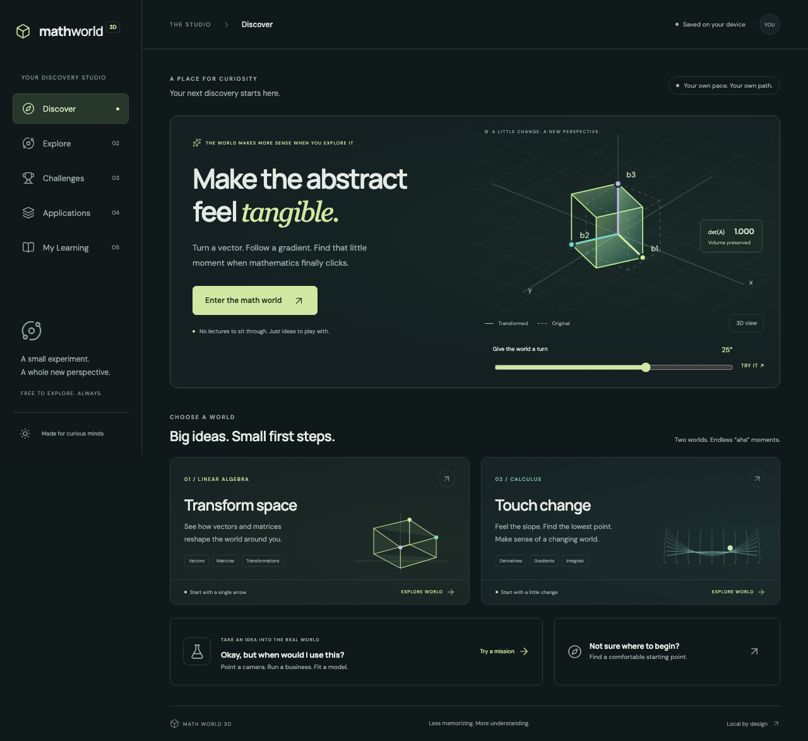

# Explore-Math

## V2 R1 learning preview — 0.3.0-preview.1

Four guided paths now connect manipulation, two worked examples, justified derivations, counterexamples and seeded practice: vector addition/projection, matrix action/determinants, derivatives/limits, and gradients/optimization. Discover begins with vectors; the five destinations and existing sandbox URLs remain. Explanation depth is a view preference, and saved attempts distinguish independent numerical work from guided practice.

Applications includes two usable project templates: vector navigation and convex production cost. Save/remix a project, export/import validated JSON, export a readable report, and reproduce the calculation with generated standalone Python. Old learning data is backed up before the additive upgrade. No new runtime dependencies or remote services were added.

The owner authorized public preview publication on October 26, 2026, with human reviews explicitly pending. The preview combines Prediction Studio PR #1 and V2 PR #2. The app labels its preview status and explains it in My Learning. Live deployment evidence is recorded in [PR #2](https://github.com/Wai-999/Explore-Math/pull/2). See the [coverage](docs/v2/CONTENT_COVERAGE.md), [tests and usability](docs/v2/TEST_AND_USABILITY_REPORT.md), [math review](docs/v2/MATH_AND_PROOF_VALIDATION.md), [research](docs/v2/LEARNING_RESEARCH_AND_DESIGN.md), and [release/backlog](docs/v2/RELEASE_AND_REMAINING_WORK.md). Passing software checks does not establish novice comprehension or educational effectiveness.

## Prediction Studio review candidate — 0.2.0-rc.2

The `feature/prediction-studio` branch adds three complete Build & Teach paths: next-day energy regression, unseen-machine maintenance classification, and next-week store-demand forecasting. Open Explore → Prediction studio, starting with the Sunday prediction contract. Each project walks through eight stages, from available information to a frozen final test, a conditional decision, and independent transfer practice.

The Prediction Studio candidate is included in the owner-authorized V2 public preview. Independent human educational validation remains pending. See the [review package](docs/review/PREDICTION_STUDIO_REVIEW.md) and [curriculum/backlog audit](docs/PREDICTION_CURRICULUM.md).

The [downloadable learning kit](public/workshops/prediction-workshops.zip) contains five executed Python notebooks, transparent algorithms and tested scikit-learn pipelines, a licensed historical UCI dataset, prediction/experiment/model-card templates, tests, source attribution, and separate worked answers. Python runs locally, not on GitHub Pages. See [workshop setup](public/workshops/README.md).

Step 7 now includes a local batch handoff: download the frozen coefficients/tree and training transforms, validate new inputs and publication times, score without refitting, and join outcomes only after they arrive. The same JSON artifact runs in the browser and the standard-library Python scorer. The fifth notebook, `handoff.ipynb`, includes a broken late-feature example, a delayed-label MAE calculation, and a separate worked answer. The handoff's outcomes are fabricated for practice; range warnings are not accuracy measurements.

Learning backups now use schema v2 and migrate v1 without deleting the original v1 browser key. Fitted teaching sessions, freeze/test locks, journals, guidance flags, structured attempts, and misconception feedback persist. The final test is hidden by the teaching workflow, not secured from source inspection. Synthetic results and passed quizzes do not establish real usefulness, causal effects, or mastery.

A standalone mathematics discovery studio. Change a matrix, descend an energy surface, and use the same mathematics to orient a camera, choose production, or fit a line. The core runs entirely in your browser, without accounts, tracking, APIs, or a backend.



## Run locally

Requires Node.js 24 and npm.

```sh
npm ci
npm run dev
```

Open the printed URL, including `/Explore-Math/`. The five destinations are Discover, Explore, Challenges, Applications, and My Learning. Hash routes survive static-host refreshes.

```sh
npm run typecheck
npm run lint
npm run format:check
npm test
npm run build
npx playwright install chromium firefox webkit
npm run test:e2e
```

## Play

- **Transform space:** edit a 3×3 matrix, use a preset, or drag a basis endpoint. Dragging changes x and y at the endpoint's current z; all three coordinates can be edited numerically. Observe determinant, orientation, rank, transformed coordinates, projections, and real xy eigenpairs. Solve a seeded satellite rotation challenge.
- **Touch change:** choose a convex bowl or two-valley surface, move a point, change the learning rate, and take gradient steps. Compare analytic and finite-difference gradients. A second 2D mode connects secants/tangents with four numerical integration rules for x².
- **Camera mission:** order fixed-world rotations and match a target direction.
- **Production mission:** maximize a synthetic daily profit model in three demand scenarios, with meaningful dollar/unit readouts.
- **Regression mission:** fit five synthetic observations, inspect residuals, and compare a separate three-point evaluation set.

Orbit by dragging empty 3D space; scroll or pinch to zoom; use **Home camera** to restore the view. The basis tips capture pointer movement while orbit is disabled. Numeric fields and native sliders provide keyboard alternatives. **2D view** preserves the calculation without WebGL. **View numbers** explains exactly what is being drawn.

Start with coordinates and multiplication in Transform space, or slope and function values in Touch change. The optional readiness question suggests a starting point without locking content. Select explanation depth in My Learning. Depth is a preference, not an assessment result.

## Privacy, progress, and limits

Progress, theme, bookmarks, and explanation depth use versioned localStorage. Export/restore uses validated JSON; restoration downloads the previous progress first. Legacy sandbox positions reset when reopened; guided experiments and saved builder projects resume locally. No telemetry or external requests are needed during play; fonts, equations, and procedural geometry are bundled locally. External reference links open only when selected.

Independent solutions are dated examples, not certified competence or demonstrated long-term retention. Opening an applied mission's worked solution marks that attempt guided. There are no fabricated mastery percentages. The math has automated verification; independent human mathematics and novice-learning reviews are still required before a production-release claim.

SVD/PCA, full 3D eigensolvers, systems/row-reduction lessons, chain-rule scenes, complete integral lessons, multivariable integration, vector calculus, and constrained optimization remain planned. They are not empty playable pages.

## Architecture and hosting

React 19 + TypeScript + Vite; Three.js + React Three Fiber; KaTeX with MathML; Vitest; Playwright; axe. Exact versions and transitive dependencies are locked. Three.js is loaded only on entering a 3D scene. See [deployment](docs/DEPLOYMENT.md), [mathematical conventions](docs/MATH_VALIDATION.md), [scene authoring](docs/SCENE_AUTHORING.md), [accessibility](docs/ACCESSIBILITY_AND_FALLBACKS.md), [test evidence](docs/TEST_REPORT.md), and [release status](docs/RELEASE_STATUS.md).

The application and newly authored teaching content are original. Educational references are recorded in the application and in the validation document. No third-party teaching text or illustrations are reproduced. Dependency license notices are retained by npm; application source is MIT licensed.
